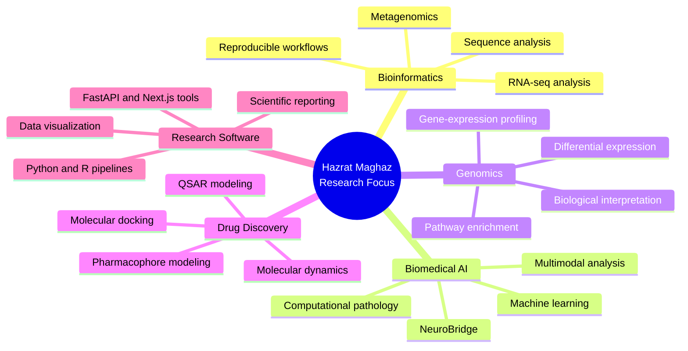

  

  

 

  
  
  

---

##  About Me

I am **Hazrat Maghaz**, a bioinformatics researcher with an **MS in Bioinformatics from the National University of Sciences & Technology (NUST SINES), Pakistan**, and a **BS in Biochemistry from Abdul Wali Khan University Mardan**.

My research interests include **computational biology, biomedical AI, genomics, transcriptomics, and computational drug discovery**. My master's research focused on integrating histopathology images and gene-expression data for CNS tumor analysis. I have also worked on computational studies involving RNA-seq analysis, QSAR modeling, protein structures, molecular docking, and molecular dynamics.

I am particularly interested in reproducible computational workflows, careful model evaluation, and biological interpretation of analytical results.

> **Research focus:** Connecting biological data, computational methods, and biomedical questions.

---

##  Research Areas

| Area | Focus |
| :--- | :--- |
| **Bioinformatics & Computational Biology** | Biological sequence analysis, gene-expression data, molecular datasets, and reproducible computational workflows. |
| **Biomedical AI & Machine Learning** | Machine learning, deep learning, multimodal representation learning, and evaluation of models for biomedical data. |
| **Genomics & Transcriptomics** | RNA-seq analysis, differential gene expression, pathway analysis, and interpretation of molecular variation. |
| **Structural Bioinformatics & Drug Discovery** | Protein structure analysis, QSAR modeling, molecular docking, molecular dynamics, and pharmacophore methods. |

---

##  Featured Research — NeuroBridge

**NeuroBridge: A Bidirectional Multimodal Deep Learning Framework for CNS Tumor Analysis Using Histopathology and Gene-Expression Profiles**

**MS Thesis | NUST SINES | Approved September 2026**

NeuroBridge is a research framework that examines how **histopathology images and gene-expression profiles** can be analyzed together using deep learning. Its main classification task concerns **GBM-like versus LGG-like** tumor patterns, rather than all CNS tumor types.

The study used paired data from **TCGA-GBM and TCGA-LGG** for development and internal evaluation. **CPTAC-GBM**, a GBM-only cohort, was used for external transfer testing; it was not an external two-class validation cohort.

The framework also includes:

- **Path2Omics:** Prediction of selected molecular targets from image-derived features, not reconstruction of full RNA profiles.
- **Gene2Morph:** Retrieval of **real histology reference patches** guided by gene-expression data, not generation of synthetic whole-slide images.
- **Missing-modality evaluation:** Assessment of model behavior when histopathology or molecular information is unavailable.

**Research overview:** [NeuroBridge on my academic website](https://hazratmaghaz.tech/research)

*NeuroBridge is an academic research prototype and is not intended for clinical diagnosis.*

---

##  Technical Stack

  

 

  
  
  
  
  
  
  
  
  

*These are tools and methods used or explored in academic and computational projects, not proficiency ratings.*

---

##  Selected Computational Projects

| Project | Methods | Description |
| :--- | :--- | :--- |
| ** Crohn's Disease RNA-seq Analysis** | `R` `DESeq2` `GSEA` | A transcriptomics workflow for differential gene-expression analysis and gene set enrichment in Crohn's disease data. |
| ** QSAR Prediction with RDKit & SHAP** | `Python` `RDKit` `scikit-learn` `SHAP` | Molecular descriptor and fingerprint analysis, predictive QSAR modeling, model evaluation, and interpretation of predictions. |
| ** hERG Pharmacophore Modeling** | `MOE` `Pharmacophore` `Virtual Screening` | A computational modeling study examining pharmacophore features and screening approaches for hERG-related compounds. |
| ** Bioinformatics with Python** | `Python` `Biopython` `Sequence Analysis` | Educational scripts covering FASTA/FASTQ processing, biological sequence analysis, and introductory bioinformatics workflows. |

These projects include independent computational studies and educational work; they are not presented as peer-reviewed publications. Their GitHub repositories are currently private and will be linked individually as they are prepared for public release.

**Further work and research figures:** [Computational Projects](https://hazratmaghaz.tech/projects)

---

##  Current Research Focus

The diagram below summarizes my main research interests and the computational methods I work with.

 

---

##  Academic Background & Research Outputs

- **MS Bioinformatics**, NUST SINES (2024–2026). NeuroBridge thesis approved in September 2026.
- **Research Assistant**, NUST SINES (2025–2026). Computational work involving histopathology images, gene-expression data, and machine-learning analysis.
- **BS Biochemistry**, Abdul Wali Khan University Mardan (2020–2024). Undergraduate thesis investigating potential HIV-1 integrase inhibitors using QSAR analysis and molecular docking.
- **CD28 structural bioinformatics study**, manuscript submitted in 2026. Acceptance or publication has not been confirmed.

---

##  GitHub Analytics

  

 

  
  

 

  
  

---

##  Research & Collaboration

I welcome discussions about **PhD research opportunities, academic collaborations, and computational projects** in bioinformatics, biomedical AI, genomics, transcriptomics, and computational drug discovery.

  
  
  

 

  <i>Interested in reproducible, biologically grounded computational research.</i>

