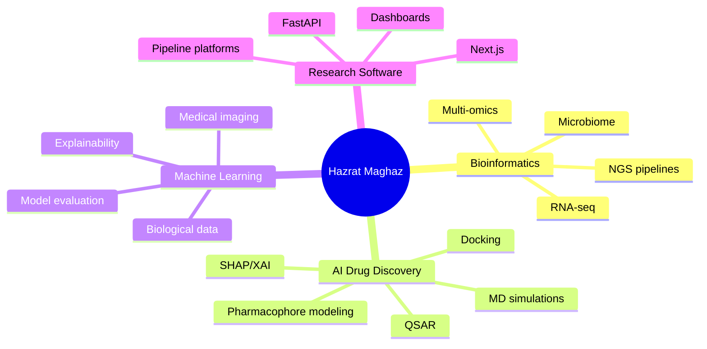

  

  

 

  
  
  

---

## 👨‍🔬 About Me

Hi, I’m **Hazrat Maghaz** — a **Bioinformatician, Computational Biologist, AI enthusiast, and research-software builder**.

I work at the intersection of **biology, machine learning, molecular modeling, and full-stack development**. My core focus is building reproducible workflows for **NGS analysis, AI-driven drug discovery, QSAR modeling, molecular docking/MD simulations, and scientific web applications**.

Alongside my academic and freelance work, I am building **InnoHelix** and **Omics Nexus** with the goal of making bioinformatics tools, training, and research workflows more accessible, reproducible, and useful for students, researchers, and biotech teams.

> **From molecules to models — bridging biology, AI, and code.**

---

## 🚀 What I Work On

| Area | What I Do |
| :--- | :--- |
| **🧬 Bioinformatics & NGS** | RNA-seq analysis, differential expression, pathway enrichment, sequence analysis, and reproducible omics workflows. |
| **💊 AI for Drug Discovery** | QSAR/pIC50 prediction, molecular fingerprints, ADMET-style modeling, SHAP-based interpretation, pharmacophore modeling, docking, and MD simulations. |
| **🤖 Machine Learning & Deep Learning** | Classical ML, explainable AI, model evaluation, computer vision, medical imaging, and biological-data modeling. |
| **💻 Research Software & Web Apps** | Python pipelines, FastAPI backends, Next.js/React interfaces, dashboards, and bioinformatics SaaS-style tools. |
| **🧪 Scientific Reporting** | Clean project documentation, visualizations, reproducible methods, and client/research-ready reports. |

---

## 🛠️ Technical Stack

  

 

  
  
  
  
  
  
  
  

---

## 📌 Featured Projects

| Project | Focus | Description |
| :--- | :--- | :--- |
| **🧬 [RNA-seq Crohn’s Disease Analysis](https://github.com/HazratMaghaz/RNAseq-Crohns-DESeq2-GSEA)** | `R` `DESeq2` `GSEA` `Transcriptomics` | Differential expression and Hallmark GSEA workflow for Crohn’s Disease RNA-seq data with organized scripts, figures, and reproducible documentation. |
| **⚗️ [QSAR IC50 Prediction with RDKit + SHAP](https://github.com/HazratMaghaz/QSAR-IC50-Prediction-RDKit-SHAP)** | `Python` `QSAR` `Scikit-learn` `SHAP` | AI-based QSAR pipeline for pIC50 prediction using molecular fingerprints, model comparison, applicability-domain diagnostics, and explainable modeling. |
| **💊 [hERG Pharmacophore Modeling in MOE](https://github.com/HazratMaghaz/Pharmacophore-Modeling-hERG-Inhibitors-MOE)** | `MOE` `Pharmacophore` `Virtual Screening` | Pharmacophore modeling workflow for hERG inhibitor screening, including feature mapping, conformer database handling, and hit evaluation. |
| **🐍 [Bioinformatics Python Basics](https://github.com/HazratMaghaz/Bioinformatics-Python-Basics)** | `Python` `Biopython` `NCBI` | Beginner-friendly Python and Biopython scripts for sequence analysis, FASTA/FASTQ handling, k-mers, ORFs, PubMed/NCBI retrieval, and learning core bioinformatics logic. |
| **🧠 Medical / Image Classification AI** | `PyTorch` `Computer Vision` `Deep Learning` | Image-classification workflows for AI/ML learning and medical-imaging style projects. This section will be updated after the repo cleanup. |
| **🌐 Research Web Tools** | `Next.js` `FastAPI` `Dashboards` | Full-stack tools and dashboards for bioinformatics workflows, model visualization, and research pipeline deployment. |

---

## 🧭 Current Focus

---

## 📊 GitHub Analytics

  

 

  
  

 

  
  

---

## 🤝 Let’s Collaborate

I’m open to **research collaborations, freelance bioinformatics projects, AI/ML workflows, computational drug discovery projects, and custom scientific dashboards**.

  
  
  

 

  <i>“Building reproducible research workflows from raw data to real insight.”</i>

